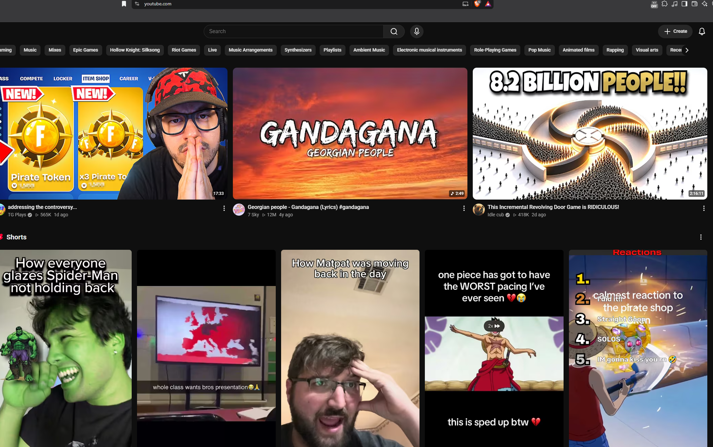

# Youtube-shorts-remover
A browser extension that removes YouTube Shorts so you do not get dragged off to scrolling for hours. 
## How it works
The extension sits next to your search bar. You can toggle it on and off. When it is turned on, YouTube Shorts get removed from your page. When you click on a link to a short video, you get sent to the actual video, not shorts. This way you can avoid them as much as possible and limit your doom scrolling.

###When it's off:

##When it's on:

